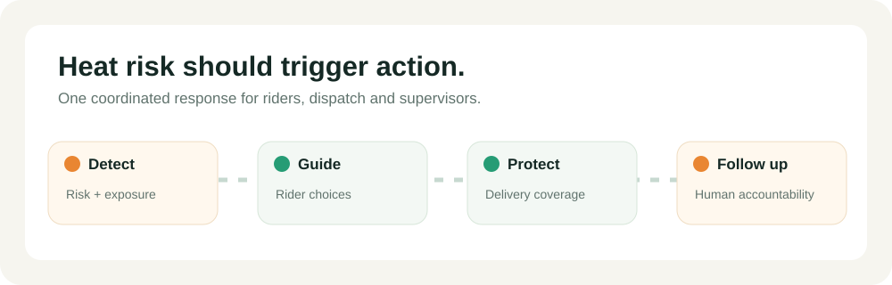
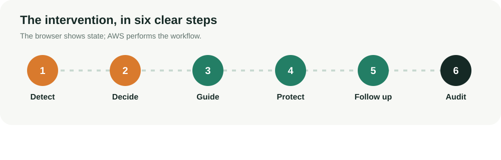
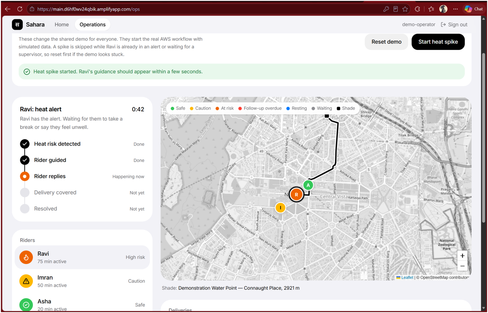
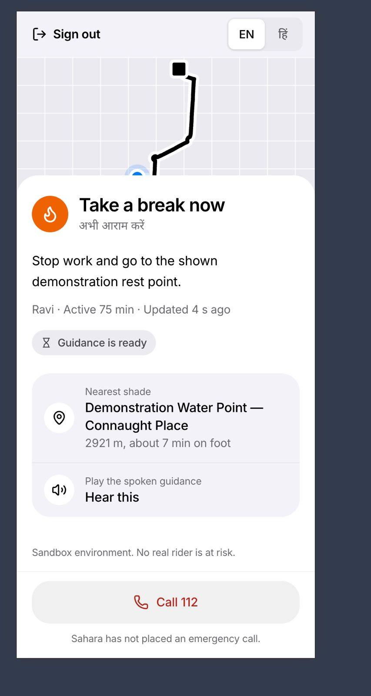
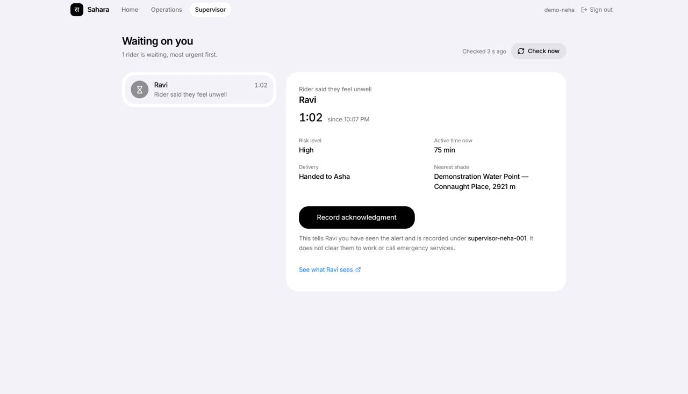
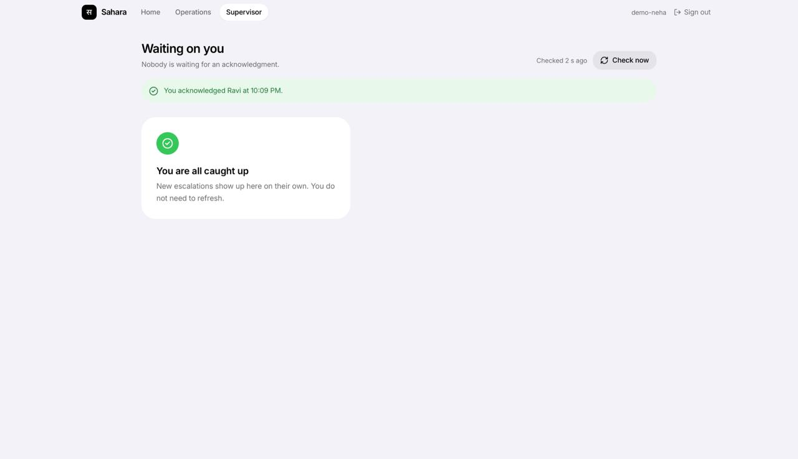
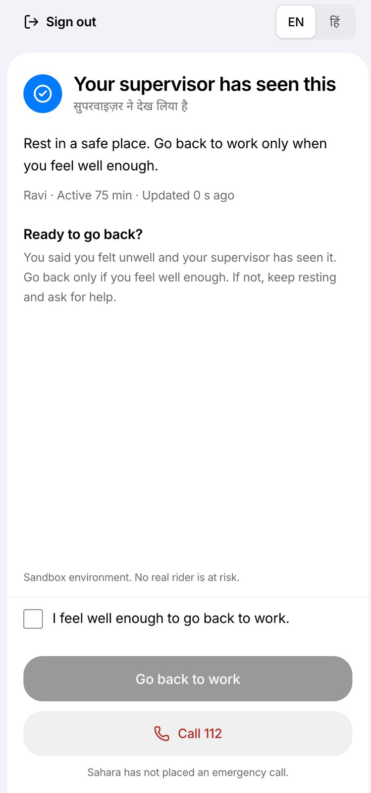
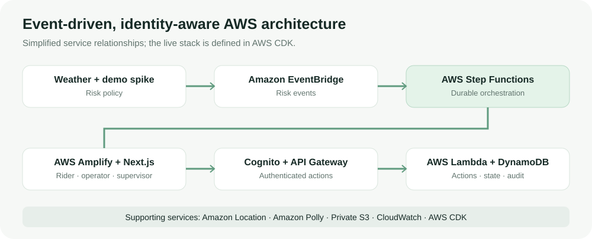
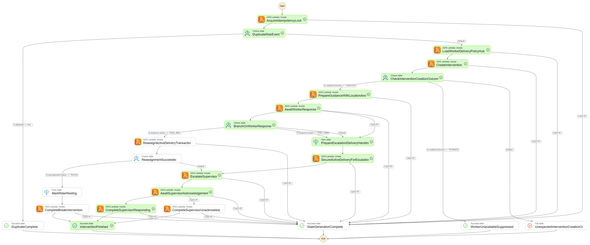

<div align="center">

# SAHARA · सहारा

### A heat warning is a signal. **Protecting the rider is the response.**

**Sahara connects heat-risk detection to actionable rider guidance, safe delivery reassignment, and accountable supervisor follow-up.**

[**Live application ↗**](https://main.d6hf0wv24qbik.amplifyapp.com) &nbsp;·&nbsp; [**Interactive walkthrough — no login ↗**](https://main.d6hf0wv24qbik.amplifyapp.com/#walkthrough) &nbsp;·&nbsp; [**AWS evidence ↗**](docs/AWS_VERIFICATION_EVIDENCE.md)

[](https://github.com/abhinav0singh/TapSaathi/actions/workflows/backend.yml) [](https://github.com/abhinav0singh/TapSaathi/actions/workflows/web.yml) 



</div>

> **Sahara** means *support*. Previously named TaapSaathi; internal AWS resource names, the repository URL and `@taapsaathi/*` package identifiers remain unchanged intentionally.

## 01 / The problem: alerts do not finish the job

When a delivery rider faces dangerous heat, a temperature warning is only the beginning. Someone still has to answer: **Can the rider safely stop? Who takes the delivery? What if the rider feels unwell or never replies? Who follows up?**

Sahara is a **single-hub, simulated heat-safety coordination prototype** built to connect those decisions. It is not a medical diagnostic tool, emergency-response service, or a claim that injury was prevented.

## 02 / Built for the people in the loop

| Delivery rider | Operations team | Supervisor |
|:---|:---|:---|
| **Understand the risk.** English/Hindi instructions, route-to-rest context and protected audio guidance. | **See the situation.** Live rider states, map, delivery ownership, active interventions and audit trail. | **Own the follow-up.** Review escalations, record acknowledgments and understand overdue outcomes. |
| **Respond simply.** Take a break or report feeling unwell. | **Keep work covered.** A delivery can be reassigned before escalation. | **Never confuse acknowledgment with clearance.** Returning to work follows separate backend rules. |

## 03 / How Sahara works



1. **Detect:** scheduled observations or a *clearly labelled simulated* heat spike enter the shared risk policy.
2. **Decide:** deterministic policy evaluates weather and continuous-exposure context; qualifying risk produces a versioned event.
3. **Guide:** an intervention provides rider guidance, a rest-route context and optional protected Amazon Polly audio.
4. **Protect:** a break or missed response triggers safe delivery handling and reassignment where possible.
5. **Follow up:** symptoms or timeouts escalate to an authenticated supervisor. Acknowledgment is not medical clearance.
6. **Record:** state changes and actions are auditable; idempotency and demo-generation checks guard against duplicates and stale work.

**Try the story yourself:** [Open the no-login interactive walkthrough](https://main.d6hf0wv24qbik.amplifyapp.com/#walkthrough). It is a local simulation on the page, **not** a live AWS execution.

## 04 / The product

| Surface | What it demonstrates |
|:---|:---|
| [**Operations command center**](https://main.d6hf0wv24qbik.amplifyapp.com/ops) | Rider roster, map, delivery assignments, intervention stages, audit feed, historical heat replay and operational metrics. |
| **Ravi's worker experience** | Mobile-first English/Hindi guidance, rest routing, protected audio, take-break / feel-unwell actions and controlled resume. |
| [**Supervisor desk**](https://main.d6hf0wv24qbik.amplifyapp.com/supervisor) | Escalation queue, acknowledgement and outstanding follow-up state. |
| [**Interactive walkthrough**](https://main.d6hf0wv24qbik.amplifyapp.com/#walkthrough) | Judge-friendly narrative without demo credentials; a local simulation that never reads or changes operational data. |

### Sahara in action — a complete rider-safety intervention

The screenshots below show the **authenticated, AWS-backed demo sandbox** using simulated riders and deliveries. Unlike the [public interactive walkthrough](https://main.d6hf0wv24qbik.amplifyapp.com/#walkthrough), these screens reflect the shared operational workflow. Screenshots are from different points in a demo sequence, not a single simultaneous state.

#### 1. Detect the heat risk and start the intervention



*Operations command center — an authorized operator starts a simulated heat spike. The AWS-backed workflow guides Ravi while the map, roster and intervention stages show the response in progress.*

#### 2. Guide the rider in the moment

<p align="center">
  
</p>

*Rider experience — bilingual heat guidance, a demonstration rest location and a spoken-guidance option. This is a sandbox: no real rider is at risk.*

#### 3. Escalate symptoms to a supervisor



*Supervisor desk — Ravi's symptom report is visible for follow-up. The delivery is shown as handed to Asha, and the supervisor can record acknowledgment.*

#### 4. Record acknowledgment — without declaring medical clearance



*Acknowledgment recorded — the supervisor queue is cleared after the action. Acknowledgment confirms follow-up, **not** that Ravi is medically cleared to work.*

#### 5. Show the rider's controlled recovery state

<p align="center">
  
</p>

*Rider recovery — Ravi sees that the supervisor acknowledged the alert. The return-to-work action requires a separate self-declaration; it is not automatically enabled by supervisor acknowledgment.*

> **Demo boundary:** The public homepage walkthrough is a deterministic browser-local simulation. The authenticated operations, rider and supervisor screenshots above depict the deployment-backed sandbox with simulated data. Neither is evidence of prevented injury, a medical diagnosis or an emergency call.

## 05 / AWS architecture: real orchestration, not browser theatre



| Layer | Technology | Why it matters |
|:---|:---|:---|
| Experience | **AWS Amplify**, Next.js, React, Leaflet | Hosted operator, rider and supervisor experiences |
| Identity | **Amazon Cognito**, API Gateway JWT authorizer | Role-bound mutations and identity-specific protected audio |
| Signals | **EventBridge Scheduler**, deterministic risk policy | Scheduled and simulated inputs use shared decision logic |
| Orchestration | **Amazon EventBridge**, **AWS Step Functions Standard**, AWS Lambda | Durable intervention lifecycle, callbacks, timeouts and escalation |
| State | **Amazon DynamoDB** | Rider and delivery state, intervention records, audit, idempotency and demo generations |
| Guidance | **Amazon Location**, **Amazon Polly**, private **Amazon S3** | Rest routing and access-controlled audio |
| Operations | **Amazon CloudWatch**, AWS CDK v2 | Observable and repeatable cloud infrastructure |

### Actual AWS Step Functions execution

The image below is an **actual AWS Console graph capture** from a successful intervention execution. Green states show the path taken; unhighlighted branches are part of the definition, not evidence that every branch ran.



*AWS Console graph — successful worker-response / delivery-reassignment path. This does not independently verify the separate PR #40 stale-generation regression.*

**Optional evidence slot 3:** replace the graph above with a tighter, redacted execution-detail screenshot showing `SUCCEEDED` and readable state names if Karan captures one. Keep the existing real screenshot until then.

## 06 / Engineering quality and safety boundaries

**Designed for failures, not only the happy path.**

- **Deterministic, versioned risk decisions** — not an opaque medical-risk score.
- **Durable workflows** — Step Functions callback waits, timeout branches, escalation and terminal states.
- **Idempotency and generation isolation** — reduce duplicate processing and stale-demo side effects.
- **Role-based security** — Cognito/JWT authorization for operator, rider and supervisor actions; rider-specific audio protection.
- **Audit trail** — records actions, transitions, reasons and operational timing without inventing health outcomes.
- **Honest fallback states** — missing map tiles, unavailable audit history and incomplete supervisor follow-up are not displayed as successes.

**Release evidence:** PR #40's backend fix was merged and deployed to `TaapSaathiStack` in `ap-south-1`; CloudFormation completed successfully, and Complete, Escalate and Respond Lambda updates reported `Successful`. The exact reset-after-missing-intervention AWS regression was **not independently re-verified**. PR #41's Sahara frontend merge (`cb159275`) deployed successfully through AWS Amplify job #27. Local tests and build checks were reported for these releases; see the linked evidence for scope and limits.

[Backend CI](https://github.com/abhinav0singh/TapSaathi/actions/workflows/backend.yml) · [Web CI](https://github.com/abhinav0singh/TapSaathi/actions/workflows/web.yml) · [AWS verification](docs/AWS_VERIFICATION_EVIDENCE.md) · [Verification status](docs/VERIFICATION_STATUS.md) · [Known limitations](docs/KNOWN_LIMITATIONS.md)

### Historical heat context, not a live forecast

The operator experience includes a fixed **Delhi historical reanalysis** example (29 May 2024, 13:00 IST), plus a separately labelled simulated continuous-exposure condition. Audit-derived intervention counts and timings are **operational metrics**, not evidence of prevented illness.

## 07 / Run locally

Requires Node.js 22–24, npm and a modern browser.

```bash
git clone https://github.com/abhinav0singh/TapSaathi.git
cd TapSaathi
npm ci
npm run build --workspace=@taapsaathi/contracts
npm run typecheck
npm test
npm run dev --workspace=@taapsaathi/web
```

Open `http://localhost:3000`. Configure local variables using the repository's examples and [deployment runbook](docs/DEPLOYMENT_RUNBOOK.md); never commit Cognito tokens, passwords, AWS credentials, signed URLs or callback tokens. Deploying CDK requires a separate authorized AWS identity and a reviewed `cdk diff`.

<details>
<summary><strong>Repository map</strong></summary>

```text
apps/web/              Next.js app: public walkthrough, operations, rider, supervisor
packages/contracts/    Shared Zod schemas and heat-risk policy
services/api/          Dashboard, rider, response, audio and events endpoints
services/demo/         Simulated heat spike, reset and seed
services/intervention/ Step Functions task handlers
services/shared/       Authorization, repositories, audit and HTTP utilities
services/weather/      Weather adapter
infra/                 AWS CDK stack and infrastructure tests
docs/                  Evidence, design, specs, runbooks and limitations
```

</details>

## 08 / Watch, verify, judge

**Recommended judge path:** [Interactive walkthrough](https://main.d6hf0wv24qbik.amplifyapp.com/#walkthrough) → [Operations](https://main.d6hf0wv24qbik.amplifyapp.com/ops) → [AWS workflow evidence](docs/AWS_VERIFICATION_EVIDENCE.md) → [Architecture](#05--aws-architecture-real-orchestration-not-browser-theatre).

**Demo video:** https://www.youtube.com/watch?v=aFP7b4rJ5xQ&t=27s

**Scope:** Sahara is a simulated single-hub hackathon prototype. It does not contact emergency services, make medical diagnoses, or declare a worker safe merely because a supervisor acknowledged an alert.

---

## Judge access (demo sandbox only)

These accounts exist only for judging a **simulated** demo. They use fake data, no real people, and will be disabled after judging. The sandbox is shared, so another judge's reset or heat spike may change what you see; use **Reset** in the operations workspace to return to a clean state.

| Role | Username | Password | Where to sign in |
|:---|:---|:---|:---|
| Operator | `demo-operator` | `TaapSaathi@Demo2026` | [Sign in](https://main.d6hf0wv24qbik.amplifyapp.com/login) |
| Rider (Ravi) | `demo-ravi` | `TaapSaathi@Demo2026` | same page |
| Supervisor | `demo-neha` | `TaapSaathi@Demo2026` | same page |

Suggested 2-minute path: sign in as Operator, trigger the simulated heat spike, open the rider screen, report feeling unwell, then acknowledge as Supervisor.
<div align="center">

### Detect the risk. Protect the rider. Keep the team accountable.

[**Open Sahara ↗**](https://main.d6hf0wv24qbik.amplifyapp.com) · [**Try the walkthrough ↗**](https://main.d6hf0wv24qbik.amplifyapp.com/#walkthrough) · [**Judge runbook ↗**](docs/JUDGE_DEMO_RUNBOOK.md)

</div>
