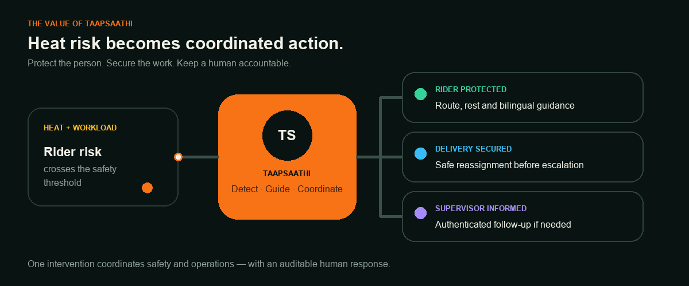
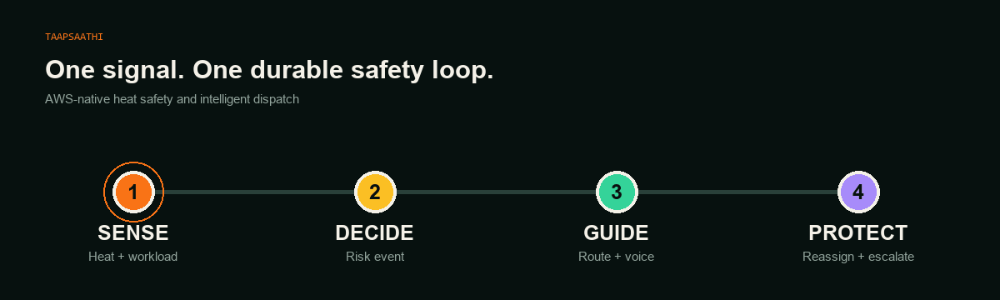
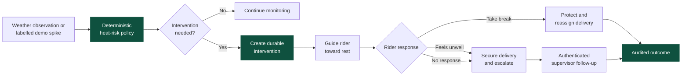
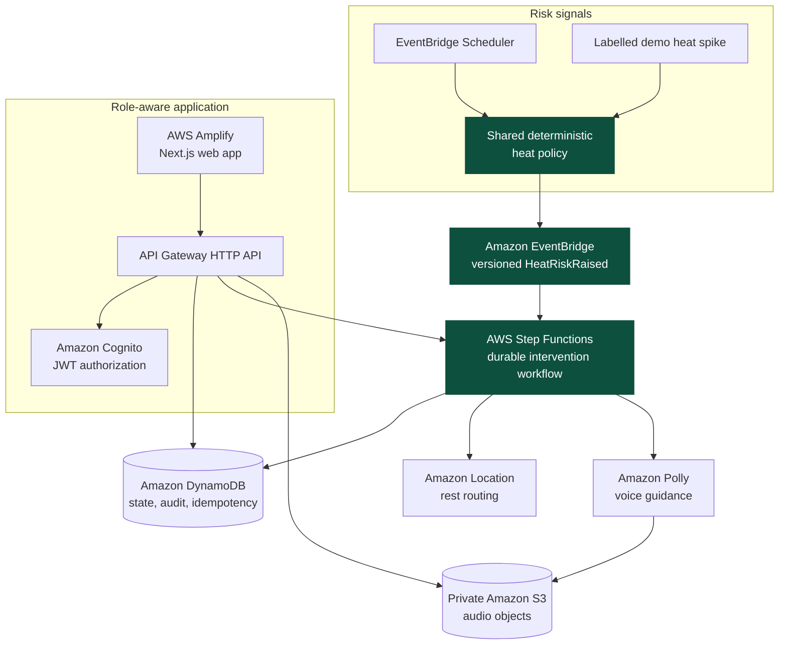

<div align="center">

# Sahara

### When heat puts a delivery rider at risk, a warning isn't enough. **Someone has to act.**

**Sahara turns heat risk into coordinated rider protection, delivery continuity, and accountable human follow-up.**

> **Naming note:** Sahara (सहारा, "support") was previously called TaapSaathi. The product name changed in the web app and in these docs. Internal names are unchanged so the deployed system keeps working: the `@taapsaathi/*` packages, the `TaapSaathiStack` CloudFormation stack, AWS resource and profile names, and the repository URL.

[](https://github.com/abhinav0singh/TapSaathi/actions/workflows/backend.yml)
[](https://github.com/abhinav0singh/TapSaathi/actions/workflows/web.yml)
[](https://main.d6hf0wv24qbik.amplifyapp.com)


**[Open the live app](https://main.d6hf0wv24qbik.amplifyapp.com)** · **[Try a no-login recorded run](https://main.d6hf0wv24qbik.amplifyapp.com/demo)** · **[See verification evidence](docs/AWS_VERIFICATION_EVIDENCE.md)** · **[Judge guide](docs/JUDGE_DEMO_RUNBOOK.md)**

</div>



> **The idea in one sentence:** Don't just warn a rider about dangerous heat; help them act, protect the delivery they're carrying, and make sure someone is accountable for what happens next.

## Why Sahara exists

A weather forecast can tell an operations team that it is hot. It cannot, by itself, answer the operational questions that matter in the moment:

- **Who needs help?** Which rider's weather conditions and continuous workload cross a defined risk threshold?
- **What should they do?** How can the rider find rest guidance and respond in a language they understand?
- **What happens to the order?** Who owns the delivery when the rider takes a break?
- **Who follows up?** What happens if the rider reports symptoms or never responds?
- **Can we prove the response?** Is there an auditable record of the decisions and actions?

**Sahara connects those answers in one event-driven workflow.** It is a prototype for delivery fleets and other organizations coordinating outdoor workers: rider safety is the primary goal, while delivery continuity and operational accountability make the response practical for dispatch teams.

| For riders | For operations | For supervisors |
| :-- | :-- | :-- |
| Clear bilingual guidance, rest-route context, optional protected audio, and explicit actions | One map for rider state, intervention progress, delivery ownership, and reassignment | Authenticated escalation, acknowledgment, and an audit trail without pretending acknowledgment is medical clearance |

## What it does — from signal to response





The operator does not manually manufacture the intervention result in the browser. The demo spike enters the same risk-evaluation and EventBridge path used by scheduled observations; AWS Step Functions manages the durable intervention lifecycle.

## Explore the product

| Experience | What you can see or do |
| :-- | :-- |
| **Operations command center** — [`/ops`](https://main.d6hf0wv24qbik.amplifyapp.com/ops) | Live map, rider roster, delivery assignments, active intervention state, audit timeline, historical replay, and operational impact metrics. |
| **Rider experience** | English/Hindi instructions, route-to-rest context, protected voice guidance, explicit **Take break** / **I feel unwell** actions, and an audited return-to-work flow. |
| **Supervisor desk** — [`/supervisor`](https://main.d6hf0wv24qbik.amplifyapp.com/supervisor) | Review an escalation and record authenticated acknowledgment. Acknowledgment is **not** medical clearance. |
| **Recorded runs** — [`/demo`](https://main.d6hf0wv24qbik.amplifyapp.com/demo) | Walk through recorded rider-break and symptom scenarios **without signing in**. These are labelled replays, not live interventions. |

**For judges:** Start with the [no-login recorded run](https://main.d6hf0wv24qbik.amplifyapp.com/demo). Then inspect the [read-only Operations dashboard](https://main.d6hf0wv24qbik.amplifyapp.com/ops). State-changing actions require the correct Cognito role; demo credentials are not published in this repository.

### Operational details that matter

**Delivery protection.** A rider taking a break should not silently retain an active delivery. The workflow secures work before reassignment and records the new owner.

**Human-in-the-loop escalation.** A symptom report or missed response can route to a supervisor. Acknowledgment records responsibility for follow-up; it does not assert that a rider is medically fit.

**Safe recovery.** After a completed break, an authenticated rider can confirm readiness to resume. Continuous active minutes reset, but previously reassigned work stays with its new rider. The symptom path has additional acknowledgment and self-declaration conditions.

**Generation isolation.** A reset starts a new demo generation so callbacks from an older intervention cannot overwrite the new simulated state.

## Historical heat replay and measurable operational impact

The Operations page includes a **fixed historical reanalysis example**, not a live forecast or official warning:

| Delhi replay input | Value |
| :-- | --: |
| Historical time | 29 May 2024, 13:00 IST |
| Air temperature | 45.6 °C |
| Apparent temperature | 44.6 °C |
| Relative humidity | 12% |
| Weather-only policy result | **CAUTION** |
| Result with a **simulated 60-minute continuous-exposure condition** | **HIGH** |

The example uses an [Open-Meteo historical archive](https://open-meteo.com/en/docs/historical-weather-api) reanalysis grid point and runs through the same shared deterministic heat-policy implementation as the backend. It is **not** a live reading, a medical assessment, or an official alert.

**Audit-derived impact cards** report current-demo-generation counts of interventions and escalations, plus recorded trigger-to-reassignment and trigger-to-worker-response durations for the first intervention where timestamps exist. Full audit history refreshes every 15 seconds while `/ops` remains open. The cards distinguish **Loading**, **Unavailable**, and successfully retrieved **zero** values; they do not claim health outcomes or prevented injuries.

## Architecture — event-driven, identity-aware, and auditable



| Layer | AWS technology | Responsibility |
| :-- | :-- | :-- |
| Experience | Amplify Hosting, Next.js, Leaflet | Public story, live operations map, rider and supervisor views |
| Authentication | Cognito, API Gateway JWT authorizer | Role-aware access; state changes and rider-specific audio are protected |
| Detection | EventBridge Scheduler, shared policy | Scheduled observations and deterministic, versioned risk decisions |
| Orchestration | EventBridge, **Standard** Step Functions | Durable waits, callbacks, escalation, and completion |
| State | DynamoDB | Worker and delivery state, interventions, audit events, idempotency, demo generations |
| Guidance | Amazon Location, Polly, private S3 | Rest routing and protected voice guidance |
| Operations | CloudWatch, X-Ray | Logs, traces, and workflow evidence |
| Infrastructure | AWS CDK v2, TypeScript | Repeatable infrastructure definitions and verification |

### Design choices

- **One policy, two entry points.** Scheduled weather and explicitly simulated spikes share the deterministic risk evaluator. The historical replay imports that same policy from `packages/contracts/src/heat-policy.ts`.
- **Durable orchestration.** Step Functions handles waits and callbacks; the UI reflects backend state rather than pretending to complete the workflow locally.
- **Identity-bound actions.** Operator, worker, and supervisor mutations require appropriate Cognito identity and server-side mapping. Protected audio is restricted to the matching rider.
- **Auditable and retry-aware.** Interventions use correlation IDs, audit records, idempotent request handling, and generation isolation.
- **Responsible fallbacks.** Route-provider availability and other limitations are recorded honestly in [known limitations](docs/KNOWN_LIMITATIONS.md); a fallback is not presented as proof of the primary provider.

## Verification — what is proven and what is pending

**Code and CI:** PR [#35](https://github.com/abhinav0singh/TapSaathi/pull/35) was approved and merged into `main` at `a87a17b`. Independent review reported **31 Vitest files / 189 tests passing**, including **5 web files / 18 tests**, plus **3/3 deterministic-policy tests**. Root and web typechecks, contracts build, CDK synthesis, state-machine validation, and production web build passed. [Backend CI](https://github.com/abhinav0singh/TapSaathi/actions/runs/38106331394) and [Web CI](https://github.com/abhinav0singh/TapSaathi/actions/runs/38106331451) passed on the PR head.

**Deployed:** The Amplify `main` branch deployed the merge. On **11 October 2026**, CloudFormation reached `UPDATE_COMPLETE` after updating the `WeatherPollFunction` and `HeatSpikeFunction` Lambda code. The live `/ops` page was visually checked in its clean state, including historical replay, map, roster, delivery ownership, and audit impact cards.

**Still to verify on the latest deployment:** A new authenticated golden-path smoke test, active-flow browser evidence across operator/rider/supervisor roles, and a redacted Step Functions execution-graph capture. Prior recorded AWS evidence is available, but should not be confused with a fresh end-to-end run after this deployment.

| Evidence | Link |
| :-- | :-- |
| Recorded golden-path runs | [Golden-path evidence](docs/GOLDEN_PATH_EVIDENCE.md) |
| AWS execution and deployment evidence | [AWS verification evidence](docs/AWS_VERIFICATION_EVIDENCE.md) |
| Current verification boundaries | [Verification status](docs/VERIFICATION_STATUS.md) |
| Judge recording and rehearsal | [Judge demo runbook](docs/JUDGE_DEMO_RUNBOOK.md) |

## Run locally

**Prerequisites:** Node.js 22–24, npm, and a supported browser. AWS deployment and authenticated actions additionally require the documented cloud configuration and permitted credentials.

```bash
git clone https://github.com/abhinav0singh/TapSaathi.git
cd TapSaathi
npm ci
npm run build --workspace=@taapsaathi/contracts
npm run typecheck
npm test
npm run dev --workspace=@taapsaathi/web
```

Open `http://localhost:3000`. For infrastructure-only checks:

```bash
npm run test:infra
npm run test:risk:policy
npm run synth
npm run verify:definition
```

Use [`.env.example`](.env.example) and the [deployment runbook](docs/DEPLOYMENT_RUNBOOK.md) to configure the frontend and AWS environment. **Do not deploy with only `http://localhost:3000` in `FRONTEND_ORIGINS` if the live Amplify frontend must remain authorized.** Inspect `cdk diff` before deployment, and monitor AWS usage and costs. Never commit credentials, JWTs, or signed audio URLs.

## Repository guide

```text
apps/web/               Next.js product, recorded demo, operations, rider, supervisor
infra/                  AWS CDK stack and infrastructure tests
packages/contracts/     Shared schemas, contracts, deterministic heat policy
services/api/           Dashboard, worker, events, response and audio APIs
services/demo/          Authenticated heat spike, reset, seed
services/intervention/  Step Functions task handlers
services/risk-engine/   Risk evaluation and event publishing
services/shared/        Authorization, state access, logging, HTTP utilities
services/weather/       Scheduled weather adapter
scripts/                State-machine checks and deployed smoke testing
docs/                   Specifications, runbooks, evidence, limitations
```

## Scope, safety, and limitations

Sahara is a **single-hub hackathon demonstration**, not a production-certified worker-safety or medical system. Demo weather, workers, locations, and deliveries are simulated unless explicitly identified as historical reanalysis. It does not diagnose conditions, guarantee safety, contact emergency services, or claim that a supervisor's acknowledgment is medical clearance. Operational response metrics are not health-outcome metrics. Public read-only views are intentional; sensitive actions and audio are identity-bound.

See [known limitations](docs/KNOWN_LIMITATIONS.md) and [project status](docs/PROJECT_STATUS.md) for scope and outstanding verification. For the latest merge/deployment context, refer to the PR and the verification section above if a status document has not yet been updated.

---

<div align="center">

### **From a heat warning to a coordinated response.**

**Protect the rider. Keep delivery ownership clear. Make every action accountable.**

[Live app](https://main.d6hf0wv24qbik.amplifyapp.com) · [Recorded demo](https://main.d6hf0wv24qbik.amplifyapp.com/demo) · [Judge guide](docs/JUDGE_DEMO_RUNBOOK.md)

</div>
