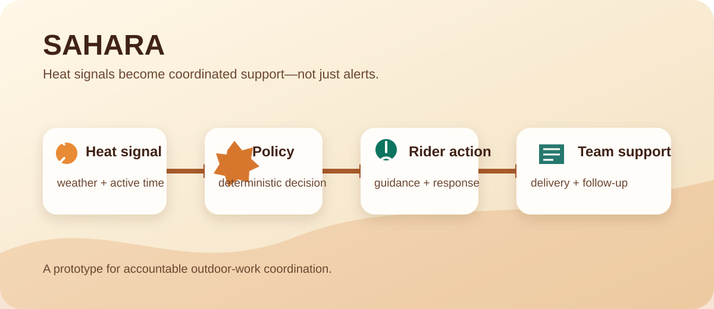
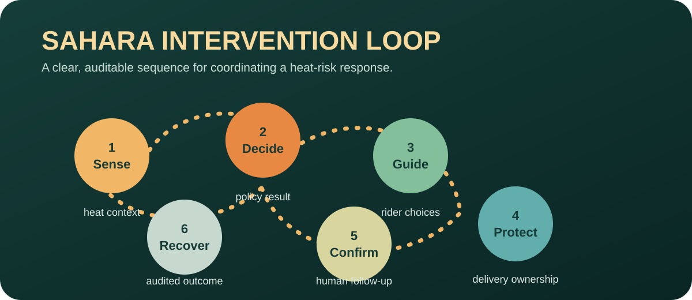
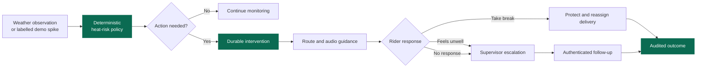
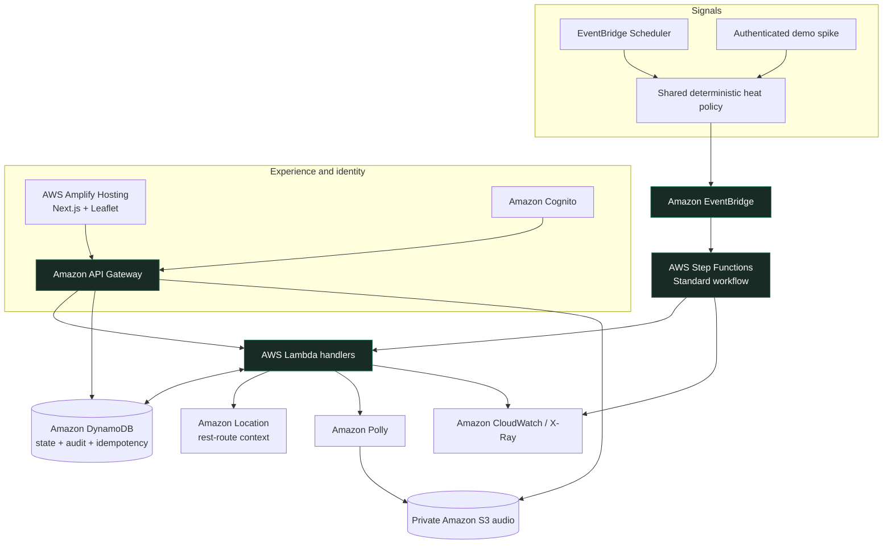

<div align="center">

# Sahara · सहारा

### A heat warning is information. **A coordinated response is protection.**

**Sahara turns heat risk for delivery riders into actionable guidance, protected deliveries, human escalation, and an auditable outcome.**

[](https://main.d6hf0wv24qbik.amplifyapp.com) [](https://main.d6hf0wv24qbik.amplifyapp.com/demo)

[](https://github.com/abhinav0singh/TapSaathi/actions/workflows/backend.yml) [](https://github.com/abhinav0singh/TapSaathi/actions/workflows/web.yml) 

**[Live experience](https://main.d6hf0wv24qbik.amplifyapp.com)** · **[No-login recorded walkthrough](https://main.d6hf0wv24qbik.amplifyapp.com/demo)** · **[AWS evidence](docs/AWS_VERIFICATION_EVIDENCE.md)** · **[Judge demo runbook](docs/JUDGE_DEMO_RUNBOOK.md)**

</div>



---

## 01 / The problem: alerts don't finish the job

A rider receives a heat warning. **What happens next?** A notification alone does not arrange a safe break, protect the delivery in progress, or tell a supervisor when a rider needs attention. For outdoor delivery work, that gap between *knowing* and *acting* matters.

Sahara is a working AWS-backed hackathon prototype that connects the whole response:

> **Detect risk → guide the rider → protect the delivery → escalate when needed → record the outcome.**

Instead of treating worker safety and dispatch operations as separate dashboards, Sahara coordinates them through one durable, event-driven intervention.

### What changes with Sahara?

| Without a coordinated response | With Sahara |
| :-- | :-- |
| A heat warning leaves the next action unclear | A deterministic policy starts an intervention when configured conditions are met |
| The rider must work out where to rest | Bilingual guidance, rest-route context, and protected voice guidance are available |
| An active delivery may remain assigned during a break | The workflow handles delivery protection and reassignment |
| Silence can go unnoticed | Timeouts lead to a supervisor escalation path |
| Decisions are hard to reconstruct | Audit events and Step Functions execution history provide operational evidence |

**Sahara does not claim to prevent heat illness or make medical diagnoses.** It demonstrates a coordinated operational response using simulated demo inputs and explicitly labelled historical weather context.

## 02 / Built for the people in the loop

<table>
<tr>
<td width="33%" valign="top">

### 🛵 Riders

**Know what to do next.**

- English and Hindi guidance
- Safety status and rest-route context
- Protected Amazon Polly audio
- **Take a break** / **I feel unwell** actions
- A controlled return-to-work flow

</td>
<td width="33%" valign="top">

### 🗺️ Operations teams

**See the situation and keep work covered.**

- Live rider status and operations map
- Intervention progress
- Delivery ownership and reassignment
- Audit timeline and operational timings
- Clearly labelled demo controls

</td>
<td width="34%" valign="top">

### 🤝 Supervisors

**Know when a human response is needed.**

- Escalation and overdue-response queue
- Worker and incident context
- Authenticated acknowledgement
- Traceable follow-up status
- No false claim of medical clearance

</td>
</tr>
</table>

## 03 / How it works: from signal to safety action





1. **Sense.** Scheduled observations or a clearly labelled simulated heat spike enter the shared risk-evaluation path.
2. **Decide.** A deterministic, versioned heat policy considers weather and configured exposure conditions.
3. **Guide.** AWS Step Functions coordinates an intervention; the rider receives understandable guidance, rest-route context, and optional protected audio.
4. **Protect.** If the rider takes a break, the system handles delivery reassignment. A symptom report or unanswered request can trigger escalation.
5. **Follow up.** An authenticated supervisor can acknowledge an escalation. Acknowledgement alone does **not** mean the rider is medically cleared.
6. **Recover and audit.** The permitted rider-resume flow and operational actions are recorded; previously reassigned deliveries are not silently reclaimed.

### A real workflow, not a UI animation

The browser does not fake successful interventions. EventBridge and AWS Step Functions coordinate backend actions and waits, while the interface reflects the current backend state. The no-login `/demo` page is a **labelled recorded walkthrough**, not a live intervention.

## 04 / See Sahara in action

> **Screenshot placeholders:** These three slots are intentionally reserved for the final, genuine screenshots. Do not replace them with mockups. Add redacted PNGs to `docs/screenshots/` and uncomment the matching image line when each file exists.

### A. Operations command center

<!-- SCREENSHOT SLOT 1: docs/screenshots/sahara-ops-dashboard.png -->
<!--  -->

> **📸 Screenshot pending — `sahara-ops-dashboard.png`**  
> Show the deployed `/ops` view: rider roster, real map, safety status, delivery assignment, and intervention/audit context.

[Open operations](https://main.d6hf0wv24qbik.amplifyapp.com/ops)

### B. Rider experience, designed for the phone

<!-- SCREENSHOT SLOT 2: docs/screenshots/sahara-rider-mobile.png -->
<!--  -->

> **📸 Screenshot pending — `sahara-rider-mobile.png`**  
> Capture Ravi's genuine authenticated worker screen at approximately **375 × 812**, showing the actual state, Hindi guidance, and route or actions when available.

### C. AWS Step Functions — execution evidence

<!-- SCREENSHOT SLOT 3: docs/screenshots/aws-stepfunctions-success.png -->
<!--  -->

> **📸 Screenshot pending — `aws-stepfunctions-success.png`**  
> Use a **real successful execution graph** with readable highlighted states and, if possible, the `SUCCEEDED` status. Redact account identifiers, execution ARNs, tokens, and sensitive metadata. A successful golden-path graph is not proof that every alternate path or the PR #40 reset regression was reverified.

**Bonus, if time allows:** [Supervisor portal](https://main.d6hf0wv24qbik.amplifyapp.com/supervisor) screenshot showing a real escalation and acknowledgement action. The three slots above are the priority.

## 05 / Features that make the response practical

| Capability | Implementation and purpose |
| :-- | :-- |
| **Deterministic heat-risk policy** | Shared, versioned risk rules rather than unexplained AI risk scores |
| **Durable intervention orchestration** | Standard Step Functions, callback waits, timeout branches, and terminal states |
| **Rider-first guidance** | English/Hindi instructions, rest routing via Amazon Location, and Amazon Polly audio |
| **Delivery continuity** | Reassignment and safe handling of active deliveries during a rider intervention |
| **Human escalation** | Supervisor follow-up when symptoms are reported or a response is missed |
| **Identity-aware access** | Cognito and API Gateway authorization for operator, rider, and supervisor actions |
| **Protected audio** | Rider-specific audio endpoint and private S3 objects; no public signed URL in dashboard payloads |
| **Operational accountability** | Audit trail, correlation identifiers, idempotent handling, and generation isolation |
| **Historical heat replay** | Explicitly historical Delhi reanalysis example, evaluated using the shared policy |
| **Measured operational response** | Audit-derived intervention counts and recorded response/reassignment latencies, not invented health outcomes |
| **Accessible product experience** | Responsive operator, rider, and supervisor interfaces with meaningful state labels |

### Historical context, honestly labelled

The Operations page includes a **fixed Delhi historical weather reanalysis example** (29 May 2024, 13:00 IST): air temperature **45.6 °C**, apparent temperature **44.6 °C**, and relative humidity **12%**. Its weather-only policy result is **CAUTION**; the displayed **HIGH** scenario additionally assumes **60 minutes of simulated continuous exposure**. It is not a live weather alert or a medical assessment. Source: [Open-Meteo historical archive](https://open-meteo.com/en/docs/historical-weather-api).

## 06 / AWS architecture



| Layer | Technology | Role |
| :-- | :-- | :-- |
| **Web experience** | Next.js 16, React 19, Tailwind CSS 4, Leaflet, AWS Amplify | Public story and role-specific responsive interfaces |
| **Authentication** | Amazon Cognito, API Gateway JWT authorizer | Identity- and role-bound actions |
| **Risk intake** | EventBridge Scheduler, shared deterministic policy | Weather observations and simulated spikes |
| **Event routing** | Amazon EventBridge | Heat-risk event delivery |
| **Orchestration** | AWS Step Functions Standard + Lambda | Intervention state, waits, retries, timeouts, callbacks |
| **Operational data** | Amazon DynamoDB | Workers, tasks, interventions, audit records, demo generations |
| **Guidance** | Amazon Location, Amazon Polly, private S3 | Rest-route context and protected audio |
| **Observability** | Amazon CloudWatch and X-Ray | Execution evidence, logs, traces |
| **Infrastructure** | AWS CDK v2 + TypeScript | Repeatable infrastructure definitions |

### Why these engineering choices matter

- **State belongs on the backend.** Refreshing a page does not erase a running Step Functions workflow.
- **Safety is not a cosmetic status badge.** Worker state and delivery assignment are persisted and exposed through shared API contracts.
- **Authorization is enforced server-side.** UI route guards complement, rather than replace, Cognito/JWT checks.
- **Retries and duplicates are expected.** Idempotency and generation-aware handling reduce the risk of duplicate or stale workflow operations.
- **A timeout is a real branch.** Missing rider and supervisor responses have defined operational outcomes, not fabricated successes.
- **Auditability is part of the product.** Operational events support a traceable demonstration and honest response-time reporting.

## 07 / Quality, testing, and evidence

**Source release:** PR [#40](https://github.com/abhinav0singh/TapSaathi/pull/40) delivered the stale-generation backend correction; PR [#41](https://github.com/abhinav0singh/TapSaathi/pull/41) delivered the Sahara web redesign. The merged frontend release `cb159275` was deployed successfully by **AWS Amplify job #27** on **11 October 2026**. The backend CDK stack reached `UPDATE_COMPLETE` and the Complete, Escalate, and Respond Lambda functions reported `Active` / `Successful` after the PR #40 deployment.

**Verification evidence:** The PR #41 author reported successful clean install, TypeScript checks, web build, and test runs; the latest documentation-only branding update reported **7 web test files / 34 tests** passing. Earlier review reported **35 Vitest files / 216 tests** for the broader suite. These counts describe different scopes and should not be conflated. AWS Amplify job #27 independently reported `SUCCEED` for the merged frontend commit.

The repository includes tests for the heat-risk policy, API authorization, intervention behavior, DynamoDB and in-memory repositories, infrastructure definitions, and frontend logic. It also provides state-machine definition validation and a deployed smoke-test script.

| Evidence | Where to inspect |
| :-- | :-- |
| Live application | [Sahara on Amplify](https://main.d6hf0wv24qbik.amplifyapp.com) |
| Public, no-login walkthrough | [Recorded demo](https://main.d6hf0wv24qbik.amplifyapp.com/demo) |
| Backend checks | [Backend GitHub Actions](https://github.com/abhinav0singh/TapSaathi/actions/workflows/backend.yml) |
| Web checks | [Web GitHub Actions](https://github.com/abhinav0singh/TapSaathi/actions/workflows/web.yml) |
| AWS evidence | [AWS verification evidence](docs/AWS_VERIFICATION_EVIDENCE.md) |
| Scenario evidence | [Golden-path evidence](docs/GOLDEN_PATH_EVIDENCE.md) |
| Rehearsal steps | [Judge demo runbook](docs/JUDGE_DEMO_RUNBOOK.md) |
| Known limits | [Known limitations](docs/KNOWN_LIMITATIONS.md) |

**Verification boundary:** The PR #40 stale-after-reset correction was deployed, but a fresh real-AWS execution specifically exercising the historical missing-intervention failure was **not yet independently verified** in the evidence available for this README. Do not interpret a successful ordinary intervention screenshot as proof that regression is closed. The frontend redesign also had some authenticated mutation flows that were not fully exercised in its pre-merge visual checks. Evidence and current status should be updated only after those checks actually pass.

## 08 / Run it locally

**Requirements:** Node.js 22–24, npm, and a modern browser.

```bash
git clone https://github.com/abhinav0singh/TapSaathi.git
cd TapSaathi
npm ci
npm run build --workspace=@taapsaathi/contracts
npm run typecheck
npm run dev --workspace=@taapsaathi/web
```

Open **http://localhost:3000**. Configure the frontend using the checked-in environment examples and [deployment runbook](docs/DEPLOYMENT_RUNBOOK.md); do not commit `.env.local`, passwords, JWTs, or signed audio URLs.

```bash
# Optional verification commands
npm run test:unit
npm run test:infra
npm run test:risk:policy
npm run synth
npm run verify:definition
npm run build --workspace=@taapsaathi/web
```

The demo uses real AWS services and can incur cloud costs. Inspect `cdk diff` before infrastructure deployment. Preserve the live Amplify origin in `FRONTEND_ORIGINS` when deploying backend changes.

## 09 / Project layout

```text
apps/web/               Sahara Next.js app, live operations, rider, supervisor, recorded demo
packages/contracts/     Shared Zod schemas and deterministic heat policy
services/api/           Dashboard, worker, response, events, audio and resume APIs
services/demo/          Authenticated demo spike and reset
services/intervention/  Step Functions Lambda handlers
services/risk-engine/   Risk evaluation and event publishing
services/shared/        State repositories, authorization and common utilities
services/weather/       Scheduled weather adapter
infra/                  AWS CDK infrastructure and tests
scripts/                Deployment smoke test and state-machine validation
docs/                   Specifications, evidence, design and judge runbooks
```

## 10 / Scope and responsible claims

Sahara is a **single-hub, simulated hackathon demonstration**, not a certified occupational safety or medical system. Simulated observations and rider data are labelled. Historical replay is not live weather. Sahara does **not** diagnose heat illness, guarantee a rider's safety, automatically contact emergency services, or treat supervisor acknowledgement as medical clearance. Operational response timings do not prove health outcomes.

The product-facing name is **Sahara (सहारा, “support”)**. The repository and deployed internal AWS identifiers retain their original **TaapSaathi** names to preserve compatibility with the running system.

---

<div align="center">

### A warning should lead to action.

**For the rider. For the delivery. For the person responsible for what happens next.**

**[Launch Sahara](https://main.d6hf0wv24qbik.amplifyapp.com)** · **[Explore the recorded demo](https://main.d6hf0wv24qbik.amplifyapp.com/demo)** · **[See the architecture evidence](docs/AWS_VERIFICATION_EVIDENCE.md)**

</div>
